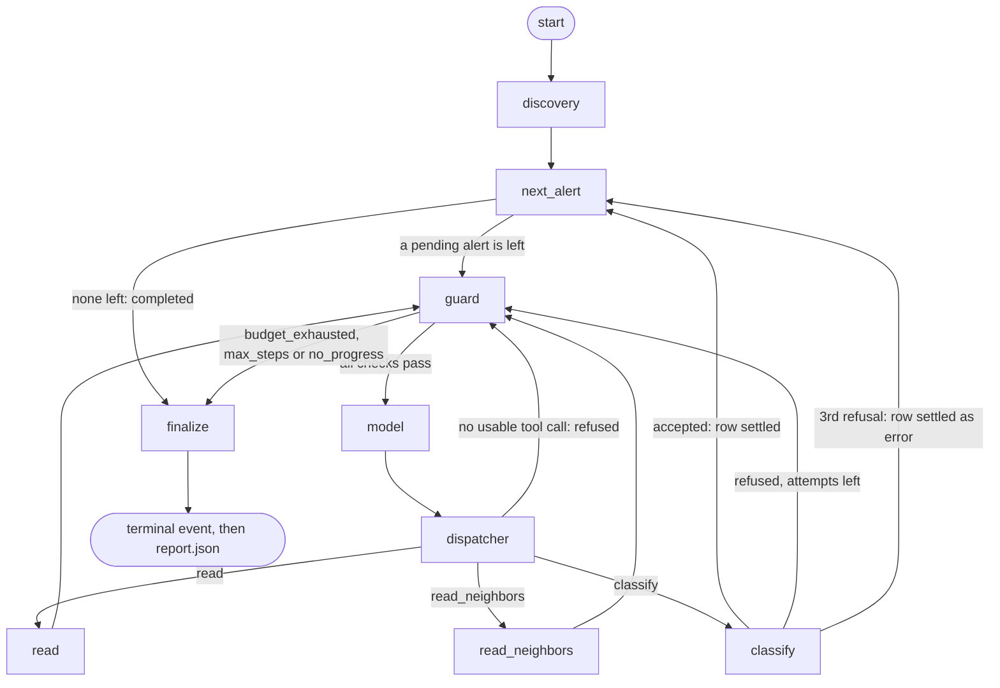

# HW1 agent - design notes

Working notes for the design report.
Everything here is a decision already made; open questions are listed at the end.

## A1. Behaviours

For each alert, which is one (query, chunk) pair, the agent:

- starts from a fresh context holding the query's text, the query's audience, and the alert's chunk with its metadata;
- may read other chunks through `read` and `read_neighbors` to get context the chunk lost when it was cut out of its page;
- decides when it has read enough, and submits a label (1 relevant, 0 not relevant), a rationale, and the chunk IDs it relied on through `classify`;
- gets exactly one row in `report.json`, whatever happens.

The agent must never:

- **answer the query.** It judges whether a chunk is relevant to the query; it does not write a reply to the student.
- **invent observations.** Only the runtime writes tool results, and every chunk cited as evidence must have been shown to the model during that same alert.
- **carry anything from one alert to the next.** Each alert has its own context and its own shown set.
- **write to the corpus or the query set.** Both are read-only inputs.
- **fetch the live ISSO site,** or reach anything outside the pinned corpus. The tools are the only way it can read.
- **read archived pages.** They are stale guidance and are refused by the shared ID check.
- **see the answer key,** its own budget counters, or other alerts' results.
- **decide anything that needs no judgment.** Budget, step and progress limits, validation, and which alert comes next belong to the runtime.

## Relevance: what the label means

This definition is used both for hand-labeling the query sets and in the agent's prompt.

A chunk is **relevant (1)** to a query when it contains information that answers the query, in whole or in part, for the person asking.
The chunk is judged in its context on the page: if its meaning depends on a neighbouring chunk, that context counts.
A chunk is **not relevant (0)** when it only points to where the answer is, when it answers the question for a different audience, or when it is on a related topic but does not answer what was asked.
The pointer rule has one exception: when the query itself asks where to look or which resource to use, a chunk that names that resource is the answer, and is a 1 (`dev-q10` asks for a housing resource, and a chunk naming Columbia's off-campus housing resources is relevant).
When the query asks for the content itself, a chunk that only says where that content is kept stays a 0, even if it confirms the content exists (`dev-q03` asks whether there are upcoming events, and a chunk that sends the reader to the events calendar is not relevant).

| Case | Label |
|---|---|
| Contains the answer | 1 |
| Contains part of the answer, even in passing | 1 |
| Only says where the answer can be found | 0 |
| Names a resource, and the query asked for a resource | 1 |
| Answers the question for a different audience | 0 |
| Answers part of the question once a neighbouring chunk is read | 1 |
| Related topic, does not answer what was asked | 0 |
| Archived (stale) content | Never reaches the agent |

### Queries with more than one part

Decided 2026-10-08, before any chunk was retrieved for the dev set.

One rule covers both shapes: a chunk that answers any one part of the query is relevant.

- **Compound queries** ask two things at once (`dev-q08`: why report my arrival, and how).
  A chunk that answers either question is a 1, even if it says nothing about the other.
- **Comparison queries** ask how two things differ (`dev-q01`: I-20 against F-1).
  A chunk that explains only one of the two is a 1, even if it never states the difference.
- **Parts that refer to each other.**
  In `dev-q02` the second part ("how does that affect me as an F-1 student") refers back to the first ("the latest OPT/CPT regulations").
  A chunk on the standing OPT/CPT rules for F-1 students is still a 1, although it says nothing about recent changes.

## Inputs: query sets and labels

```
agent/
  queries/
    dev/queries.json         <- --input agent/queries/dev
    heldout-a/queries.json
    heldout-b/queries.json
  labels/
    dev.worksheet.json                 <- the answer key, outside every --input folder
```

A query set is one target.
The scan settings, the `[scan]` config keys, are the corpus version and `k` (decided 2026-09-30).
The embedding model belongs to the corpus version and is not a key of its own.
There is no similarity threshold, so an off-topic query still sends `k` alerts to the agent.
Audience is not a scan key: it is per query, in the query file. Excluding archived chunks is a fixed runtime rule, not a key.
Each entry has an `id` (`dev-q01`, `heldout-a-q01`: set name plus a zero-padded number), the query `text`, and an `audience`.
An `alert_id` is the query ID plus the chunk ID, for example `dev-q03::applying-visa-students::0`.
Report rows are ordered by query ID, then page, then chunk index as an integer.

### The answer key

Decided 2026-10-08.

- Labels are keyed by `alert_id`, the same string as a report row, so scoring is a join on one field.
  A query ID alone is not enough: one query has `k` alerts, each with its own label.
- The key records the corpus version it was labeled against.
  Chunk IDs and the top `k` for a query only mean something for one corpus, so labels from one version cannot score a run on another.
- The key holds only the pairs that discovery returned on the day of labeling.
  A later run can report an alert that was never labeled (a different `k`, a changed audience on a query, a rebuilt corpus).
  The scoring script stops with an error when a report row has no label; it does not skip the row or count it as wrong.

## A2. State machine



A crash is not drawn: an unexpected exception in any node jumps to `finalize` through the `finally` block, with terminal status `crashed`.
In code, `finalize` is not a LangGraph node. The routing functions send planned endings to `END`, and the runner (`agent/src/run.py`) calls `finalize` in its `finally` block, so the same code finishes planned and crashed runs. The `crashed` default lives in the runner, not in the graph state, so a set `terminal_status` in the state always means a planned ending.

## A3. Nodes and edges

### Nodes

| Node | What it does | Writes state? |
|---|---|---|
| `discovery` | Runs once. Retrieves the top `k` chunks for every query, builds the alert list, and prefills every report row as `pending` | Yes: the alert list and the rows |
| `next_alert` | Picks the next `pending` alert and resets the per-alert state, or finds none left | Yes: resets per-alert state, or sets `terminal_status` to `completed` when none is left |
| `guard` | Runs before every model call. Checks the token budget, `max_steps` and the no-progress streak | Only `terminal_status`, and only when a limit is hit. A routing function after it sends the run to `finalize` when a status is set, otherwise to `model` |
| `model` | Sends the alert's prompt and message history to the model, with a tool call required | Yes: appends the reply, adds the reported token usage |
| `dispatcher` | Validates the model's reply and routes it to the tool it named. Refuses a reply with no usable tool call | Yes: the refusal, when it refuses |
| `read`, `read_neighbors`, `classify` | Run the tool (contracts in A5) and write its result | Yes: shown set, no-growth streak, `classify` refusal count, the settled row |
| `finalize` | Settles leftover `pending` rows, writes the terminal event, writes `report.json` | Yes: rows, trace, report |

### Edges

| Edge | Fixed or conditional | Who decides | Depends on |
|---|---|---|---|
| `discovery` → `next_alert` | Fixed | Runtime | Nothing |
| `next_alert` → `guard` or `finalize` | Conditional | Runtime | Whether a `pending` alert is left |
| `guard` → `model` or `finalize` | Conditional | Runtime | Whether the guard set `terminal_status` (it checks the budget, the step count and the no-progress streak) |
| `model` → `dispatcher` | Fixed | Runtime | Nothing: every reply goes to the dispatcher |
| `dispatcher` → `read`, `read_neighbors` or `classify` | Conditional | Model | Which tool the model named. Recorded as a `routing` event with `by: "model"` |
| `dispatcher` → `guard` (refusal) | Conditional | Runtime | The reply has no usable tool call. Recorded as a `routing` event with `by: "runtime"` |
| `read`, `read_neighbors` → `guard` | Fixed | Runtime | Nothing |
| `classify` → `next_alert` or `guard` | Conditional | Runtime | Whether the submission passes validation, and on a refusal whether it was the third. The model proposes; the runtime decides the alert is over |

## A4. Agent state

| Field | Lifetime | Reducer | Written by | Model sees it |
|---|---|---|---|---|
| Alert list | Per run | Written once | `discovery` | No |
| Report rows | Per run. A dict keyed by `alert_id`, prefilled with `pending` | Insert-once: settling a settled row raises | `discovery` (prefill), `classify` (a classified row, or an error row on its third refusal), `finalize` | No |
| Tokens used | Per run | Sum | `model`, from the usage the provider reports | No: it is irrelevant to judging relevance |
| Step count | Per run | Sum. One step is one model call | `model` | No |
| Trace | Per run | Append | Every node | No |
| Message history sent to the model | Per alert (a fresh context for each alert) | Append | `model`, the tool nodes | Yes: it is the model's input |
| Shown chunk set | Per alert. Starts with the alert's own chunk | None (overwrite): the tool node returns the whole new set | `read`, `read_neighbors`; reset by `next_alert` | No (it sees the chunks themselves, in its message history) |
| No-growth streak | Per alert | None (overwrite). The tool node compares the shown set before the step with the ids it returned, and writes the old streak plus one when nothing new was shown, or zero when the set grew | The tool nodes and the dispatcher's refusal; reset to zero by `next_alert` | No |
| `classify` refusal count | Per alert | None (overwrite): the tool node writes the new count | `classify`; reset by `next_alert` | Yes: each refusal message says which attempt it was, out of 3 |

## A5. Tool contracts

The model can call three tools.
It only requests a call: the dispatcher validates the request, runs it, and writes the result.

| | `read` | `read_neighbors` | `classify` |
|---|---|---|---|
| **Purpose** | Show the model one chunk | Show the model the chunks next to one chunk, for context that was cut off | Hand in the model's judgment for the current alert |
| **Arguments** | `chunk_id`: string, `{page}::{index}` | `chunk_id`: string, `{page}::{index}` | `label`: integer, 0 or 1. `rationale`: string. `evidence`: list of chunk IDs |
| **Returns on success** | The chunk's text and its metadata: `heading`, `breadcrumb`, `audience` | The previous and next chunk on the same page, each with its chunk ID and text. One chunk at the edge of a page. An empty list for a single-chunk page | Confirmation. The runtime settles the alert's row and the alert ends |
| **Limits** | One chunk per call | Fixed at one chunk each side. To see further, call it on a neighbor's ID | `rationale` is at most 600 characters. At most 3 refused attempts per alert |
| **Refuses when** | `chunk_id` fails the shared check: malformed, nonexistent, or on an archived page | `chunk_id` fails the shared check: malformed, nonexistent, or on an archived page | `label` is not the integer 0 or 1 (the string `"1"` is refused). `rationale` is empty or over 600 characters. `evidence` is empty, is not a list of chunk IDs, or cites a chunk that is not in this alert's shown set |
| **Effect on state** | Adds the chunk to the alert's shown set | Adds each returned chunk to the alert's shown set | On success, settles the row (insert-once) and emits its `state_change` event |
| **Counts toward the no-progress streak** | Yes, when it shows nothing new or is refused | Yes, when it shows nothing new or is refused | No. Refusals are bounded by the 3-attempt cap instead |

### Rules for every tool

- A refusal goes back to the model as an observation (`ok: false` with an `error` message), never as a crash.
- An unknown tool name is refused the same way.
- A reply with no usable tool call is refused by the dispatcher and counts as a step that showed nothing new.
- All chunk IDs are validated by one shared function, so the archived rule lives in one place and no tool can skip it.
  This is the equivalent of the handout's single path check (section 7).
- No tool takes a `query_id`.
  The runtime knows which alert is being worked on, and does not ask the model for something it already knows.

### When `classify` keeps failing

On the third refused `classify` for one alert, the `classify` node settles that alert as `error` itself and the run moves to the next alert.
The run continues.

### Error rows

An `error` row has `label: null`, `evidence: []`, and a rationale written by the runtime that says what went wrong.

In `report.json`, evidence is a list of `{path, line}` pairs, the same way the row itself points at its chunk (decided 2026-10-15).
The model cites chunk IDs, which `classify` validates against the shown set; the runtime converts them to pairs when it builds the row, with `line` an integer.

After the dispatcher, the run goes to `next_alert` when the current alert's row is no longer `pending` (accepted, or settled as `error` on the third refused `classify`), and to `guard` otherwise.

| Cause | Rationale the runtime writes |
|---|---|
| 3 refused `classify` attempts | "classify was refused 3 times; last reason: <the last refusal message>." |
| No-progress detector fired on this alert | "No new chunk was shown in 3 consecutive steps." |
| Crash | "The run crashed before this alert was classified." |

## A6. Terminal statuses

`terminal_status` is set to `crashed` before the `try`, and each planned ending overwrites it.
The `finally` block in the runner calls `finalize`, which settles leftover `pending` rows, writes the terminal event, then writes `report.json`.

| Terminal status | Trigger | Alert in progress | Unstarted alerts |
|---|---|---|---|
| `completed` | Every alert is settled | none | none |
| `budget_exhausted` | The token budget check before a model call fails | `budget_exhausted` | `budget_exhausted` |
| `max_steps` | The run's step count (model calls) reaches the cap | `budget_exhausted` | `budget_exhausted` |
| `no_progress` | 3 consecutive steps with no new chunk shown (refused `read` and `read_neighbors` calls included) | `error` | `budget_exhausted` |
| `crashed` | An unexpected exception | `error` | `error` |

The row status `budget_exhausted` means "the run stopped before this alert was classified", whatever the limit was.
The terminal status in the trace says which limit it was.

Every loop has exactly one bound:

| What could loop forever | What stops it |
|---|---|
| Bad `classify` attempts | The cap of 3 per alert: the alert becomes `error`, the run continues |
| Reads that show nothing new | No-progress, N = 3 (a config key): the run ends |
| Anything else | `max_steps` and the token budget: the run ends |

## A7. Workspace and withholding

The model has no file access of its own.
Every model reply goes to the dispatcher, so the only things the model can ever see are its prompt and what the three tools return.
Withholding is therefore enforced in two places: what the runtime puts in the prompt, and the one shared chunk-ID check.

| Withheld | Why | How |
|---|---|---|
| The answer key (labeled query-chunk pairs) | Seeing it makes the measurement meaningless | The agent process never opens it. Scoring is a separate script |
| Archived pages | Stale guidance that left the ISSO site; a different point in time from the pinned corpus, like `.git/` in the handout | Excluded at discovery, and refused by the shared ID check in every tool |
| Other alerts' conversations, labels and rationales | Alerts for the same query are near neighbours, the closest thing here to the handout's safe twins | A fresh context and shown set per alert |
| Run-level counters (tokens, steps, streaks) | Irrelevant to judging relevance | Never placed in the prompt |

Still to decide: see Open.

## Open

- A7: whether the prompt shows the alert's cosine score or rank.
- A7: where the corpus the tools read from lives during a run (the handout asks for a disposable copy of the input), and so what "restoring" means here.
- Pages with more than one audience. `audience` is a single value read from the breadcrumb, but the site's navigation lists some pages under two audiences ("About Your Visa" is under both For Students and For Scholars, and is recorded as `students` only).
- How the corpus records its embedding model, so a mismatch is caught at startup (decided that it should; today the model is only hardcoded in `src/config.py`).
- The dev query set: 10 queries are written (30 alerts at `k = 3`); they still need discovery run and hand labels, before any agent run. Then the two held-out sets.
- The answer key: the exact file layout of `labels/dev.json`, and what the scoring script does with a label that has no report row.
