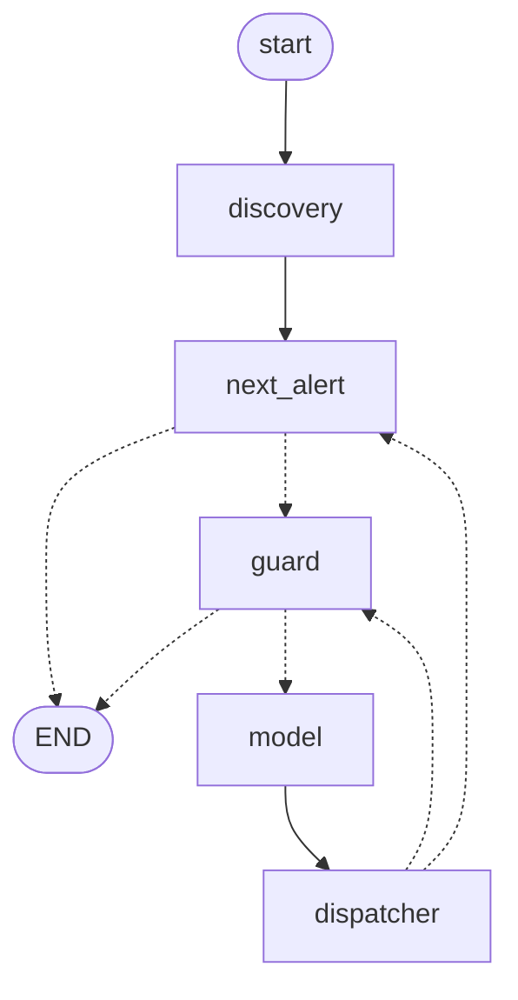
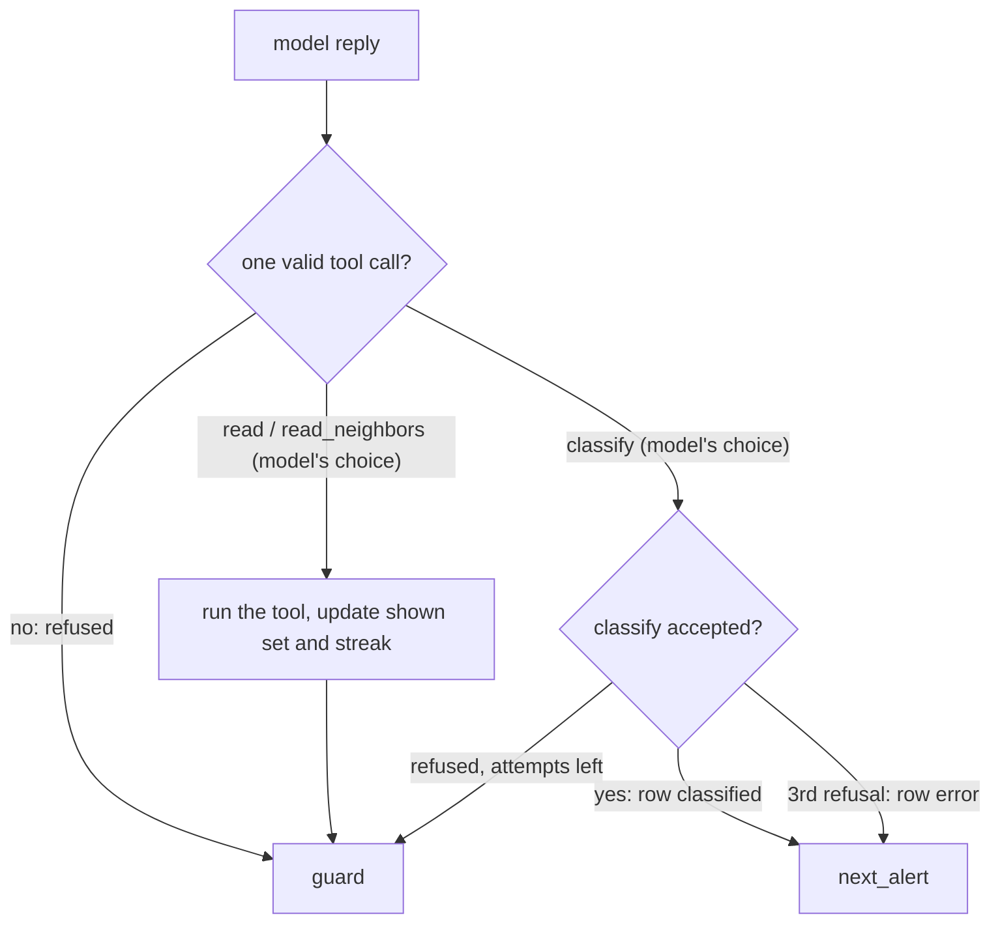
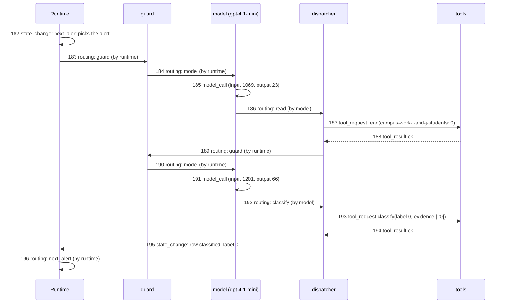

# HW1 design report: a bounded relevance-classification agent

COMS E6998-019, Fall 2026.
This assignment substitutes the Bandit alert classifier with relevance classification over the ISSO RAG corpus.
Setup and run instructions are in [`agent/README.md`](README.md); the working design notes are in [`agent/DESIGN.md`](DESIGN.md).

## The task, mapped onto the handout

| Handout | Here |
|---|---|
| A pinned target repository (`--input`) | A query set: a folder holding `queries.json` (`agent/queries/dev`, `heldout-a`, `heldout-b`) |
| Discovery: Bandit over the `[scan]` scope | Retrieval: the top `k` chunks of the pinned corpus for each query (`[scan] corpus_version`, `k`) |
| An alert | One (query, chunk) pair; `alert_id` is `<query id>::<chunk id>`, `path` is the page, `line` the chunk index |
| Label 1 / 0 | The chunk is / is not relevant to the query, for the person asking |
| OWASP BenchmarkPython (dev, open key) | The dev set: 10 queries, 30 alerts, hand-labeled before any agent run (`agent/labels/dev.worksheet.json`) |
| Radicale, SGLang (held out) | `heldout-a` and `heldout-b`: 8 queries, 24 alerts each, never tuned against |

### What the label means

A chunk is relevant (1) when it contains information that answers the query, in whole or in part, for the person asking.
It is judged as the chatbot's generator sees it: its own text, heading and page; `src/query.py` sends each retrieved chunk with its source, heading and URL, and never its neighbours.
Other chunks may explain what the chunk means (what "this form" refers to, which list an item belongs to), but never add to what it says.
A chunk is not relevant (0) when it only points to where the answer is, answers for a different audience, is on a related topic without answering what was asked, or comes from a page about a different situation than the asker's.
Pointers are relevant only when the query itself asks for a resource.
A chunk that answers any one part of a compound or comparison query is relevant.
The full rules and their cases are in `agent/DESIGN.md`, "Relevance"; the same rules are in the agent's prompt and were used for the hand labels.

## A1. Behaviours

For each alert, the agent:

- starts from a fresh context holding the query's text, the asker's audience, and the id of the chunk to judge (only the id: the agent reads the chunk itself);
- reads the chunk with `read`, and may read other chunks with `read` or `read_neighbors` when the chunk's own words cannot be understood without them;
- decides when it has read enough, and submits a label, a rationale of at most 600 characters, and the chunk ids it relied on (always including the chunk being judged) through `classify`;
- gets exactly one row in `report.json`, whatever happens to the run.

The agent must never:

- **run target code or write to the target.** The corpus and the query set are read-only inputs; the tools only read, and they read a disposable copy (A7).
- **invent observations.** Only the runtime writes tool results; every chunk cited as evidence must have been shown to the agent by a tool during that same alert, which `classify` checks against the alert's shown set.
- **answer the query.** It judges relevance; it does not write a reply to the student.
- **carry anything from one alert to the next.** Each alert has its own message history and shown set.
- **reach anything outside the pinned corpus,** such as the live ISSO site; the tools are its only way to read.
- **read archived pages, embeddings or the answer key** (A7).
- **decide anything that needs no judgment.** Budget, step and progress limits, validation, and which alert comes next belong to the runtime; the model decides only what to read, when it has read enough, and the label.

## A2. State machine

The graph as built (`agent/src/graph.py`), as LangGraph draws it; solid edges are fixed, dotted edges conditional:

The tool step, inside `dispatcher`:

`END` is reached in two ways: `next_alert` finds no pending alert (`completed`), or `guard` finds a limit reached (`budget_exhausted`, `max_steps`, `no_progress`).
A crash is not an edge: an exception in any node leaves the graph, and the runner's `finally` block (`agent/src/run.py`) runs the same finishing code as a planned ending.
Finishing (`finalize`) is deliberately not a graph node for that reason.

## A3. Nodes and edges

| Node | What it does | Writes |
|---|---|---|
| `discovery` | Runs once. Retrieves the top `k` chunks for every query, builds the alert list, prefills every row as `pending` | Alert list, rows |
| `next_alert` | Picks the next `pending` alert and resets the per-alert state, or sets `completed` when none is left | Current alert, message history, shown set, streak, refusal count; or `terminal_status` |
| `guard` | Before every model call: checks the no-progress streak, `max_steps` and the token budget | `terminal_status`, only when a limit is reached |
| `model` | Sends the alert's message history with the three tool definitions, a tool call required, no parallel calls, `max_completion_tokens` = the output allowance | The reply, one step, the reported tokens |
| `dispatcher` | Validates the reply and runs the tool the model named; refuses a reply with no usable call, an unknown tool or bad arguments, as an observation | Tool replies, shown set, streak, refusal count, a settled row |

| Edge | Kind | Decided by | On |
|---|---|---|---|
| start → `discovery` → `next_alert` | Fixed | Runtime | Nothing |
| `next_alert` → `guard` or END | Conditional | Runtime | Whether a pending alert is left |
| `guard` → `model` or END | Conditional | Runtime | Whether the guard set a terminal status |
| `model` → `dispatcher` | Fixed | Runtime | Nothing: every reply is validated |
| Inside `dispatcher`: `read`, `read_neighbors` or `classify` | Conditional | **Model** | Which tool it named; traced as `routing` with `by: "model"` |
| `dispatcher` → `next_alert` or `guard` | Conditional | Runtime | Whether the alert's row is settled (accepted, or the 3rd refused `classify`); the model proposes, the runtime decides the alert is over |

Every conditional edge writes a `routing` event with `decision` and `by`.

## A4. Agent state

Graph state (`agent/src/state.py`, `AgentState`):

| Field | Lifetime | Reducer | Written by | Model sees it |
|---|---|---|---|---|
| `alert_list` | Run | Written once | `discovery` | No |
| `report_rows` | Run; a dict keyed by `alert_id`, prefilled `pending` | Insert-once: settling a settled row raises, ending the run `crashed` | `discovery` (prefill), `dispatcher` (classified, or error on the 3rd refusal) | No |
| `used_tokens` | Run | Sum | `model`: input + output as reported | No |
| `step_count` | Run | Sum; one step is one model call | `model` | No |
| `terminal_status` | Run; unset until a planned ending | Overwrite | `next_alert` (`completed`), `guard` (a limit) | No |
| `current_alert_id` | Alert | Overwrite | `next_alert` | No (it sees the chunk id in its opening message) |
| `message_history` | Alert; a fresh context each alert | Append; reset with an overwrite | `next_alert` (opening messages), `model`, `dispatcher` | Yes: it is the model's input |
| `shown_chunks` | Alert; starts empty | Overwrite: the whole new set | `dispatcher` (successful `read`, `read_neighbors`); reset by `next_alert` | No (it sees the chunks themselves) |
| `no_growth_streak` | Alert | Overwrite | `dispatcher`: +1 when a step showed nothing new or was refused, 0 when the set grew; reset by `next_alert` | No |
| `classify_refusal_count` | Alert | Overwrite | `dispatcher`; reset by `next_alert` | Yes: each refusal says which attempt it was, of 3 |

Outside the graph state, in the frozen `RunContext` every node and router receives: the fixed settings (input and output folders, corpus version, `k`, model, temperature, budget and limits), the workspace path, and the tracer.
The trace is not state: every node and router appends to it as it acts, so a crash keeps every event written before it.

## A5. Tools

| | `read` | `read_neighbors` | `classify` |
|---|---|---|---|
| **Purpose** | Show one chunk | Show the chunks before and after one chunk on its page, to interpret the chunk's own words | Submit the judgment for the current alert |
| **Arguments** | `chunk_id`: `{page}::{index}` | `chunk_id`: `{page}::{index}` | `label`: 0 or 1; `rationale`: string; `evidence`: list of chunk ids |
| **Returns** | The chunk's id, text, heading, breadcrumb and audience | The previous and next chunk, each in the same shape; one at a page edge; none on a single-chunk page | Confirmation; the runtime settles the row |
| **Limits** | One chunk | One chunk each side; call again on a neighbour to go further | Rationale at most 600 characters; at most 3 refused attempts per alert |
| **Refuses** | Malformed or nonexistent id (archived pages are not in the copy) | The same | Label not the integer 0 or 1; rationale empty or over 600 characters; evidence empty, not a list of ids, citing a chunk not shown in this alert, or not including the chunk being judged |
| **State** | Adds the chunk to the shown set | Adds the returned chunks | On success, settles the row and writes its `state_change` event |
| **No-progress streak** | +1 when it shows nothing new or is refused | The same | Not counted: bounded by the 3-attempt cap |

All three validate chunk ids through one shared function (`validate_id`) against the run's corpus copy, the equivalent of the handout's single path check.
A refusal goes back to the model as an observation (`ok: false` with the reason), never as a crash; an unknown tool name, arguments that are not a JSON object, a missing `chunk_id`, and a reply with no tool call are refused the same way by the dispatcher.
No tool takes a query id: the runtime knows the current alert.
On the third refused `classify`, the alert's row is settled as `error` with a runtime-written rationale ("classify was refused 3 times; last reason: ...") and the run moves on.

## A6. Start, stop and termination

The runner sets `terminal_status = "crashed"` before the run starts, and each planned ending overwrites it.

| Terminal status | Trigger | Alert in progress | Unstarted alerts |
|---|---|---|---|
| `completed` | `next_alert` finds no pending alert | none | none |
| `budget_exhausted` | Before a model call, `used_tokens >= max_tokens` | `budget_exhausted` | `budget_exhausted` |
| `max_steps` | Before a model call, the step count has reached `max_steps` | `budget_exhausted` | `budget_exhausted` |
| `no_progress` | Before a model call, `no_progress_limit` (3) consecutive steps showed no new chunk, refusals included | `error` | `budget_exhausted` |
| `crashed` | Any unexpected exception, including a bug caught by the insert-once rows | `error` | `error` |

The statuses are mutually exclusive: the guard checks no-progress first, then `max_steps`, then the budget, and stops at the first that fires; a crash is only the status when no planned ending was reached.
Every loop has one bound: bad `classify` attempts by the 3-attempt cap (the alert becomes `error`, the run goes on), reads that show nothing new by the no-progress detector, and everything else by `max_steps` and the budget.

**Finishing.**
In the runner's `finally` block, planned or crashed, `finalize` (`agent/src/report.py`):

1. settles every row still `pending` by the table above, writing one `state_change` event per row;
2. writes `report.json`, rows ordered by path, then line as an integer, then test id;
3. writes the `terminal` event last, in its own `finally`, so it is written even if writing the report fails; that failure turns the status into `crashed`.

The trace file is closed in a further `finally`.
A bad config, a missing `queries.json`, a corpus that does not match `[scan] corpus_version`, or a failure to write the workspace copy stop the agent before the tracer exists: no run started, so no files are written.

**Budget policy.**

- *Charge:* input + output tokens exactly as the provider reports them in each response's `usage`, summed over every model call; `cache_read` is recorded in the trace and never charged.
- *When checked:* by the guard, before every model call; a call that has started is never cut off.
- *Output allowance:* sent on every call as `max_completion_tokens = output_allowance`.
- *At the cutoff:* the run ends `budget_exhausted`; the alert in progress and every unstarted alert get a `budget_exhausted` row, with label null.
- *Overshoot:* because the check is before the call, the last call can take the total past `max_tokens`, by at most one call's input plus `output_allowance`.
  In the three low-budget runs the overshoot was 961, 1070 and 1063 tokens on a 20000 budget.

## A7. Workspace and withholding

The model has no file access: everything it sees is its prompt and what the three tools return.
Withholding is enforced in three places: what the runtime puts in the prompt, the disposable corpus copy the tools read, and the shared chunk-id check.

**The disposable copy.**
Before the run, the CLI writes a copy of the corpus into a `tempfile.TemporaryDirectory`, and the tools read only that copy (`agent/src/workspace.py`).
It holds only what the model may see: the chunks of every page that is not archived, with `id`, `source`, `url`, `heading`, `text`, `breadcrumb` and `audience`.
Embeddings and archived pages are not in it at all, so withholding them does not depend on the id check being free of bugs.
The copy is built from the records read once at startup, the same read that is hashed and checked against `[scan] corpus_version`; discovery, which is not a model tool and needs the embeddings, reads the original, and both come from that one read.
The directory is deleted when the run ends, planned or crashed.
Restoring needs nothing: the original corpus is only ever read.

| Withheld | Why | How |
|---|---|---|
| The answer key | An agent that sees it measures nothing | It lives in `agent/labels/`, outside every input folder and the corpus; no agent code opens it; scoring is a separate script |
| Archived pages | Stale guidance from a different point in time than the pinned corpus, like `.git/` in the handout | Excluded at discovery and left out of the copy; refused as nonexistent |
| Embeddings | They encode the retriever's view, not text a judge needs | Left out of the copy |
| Other alerts' conversations, labels and rationales | Alerts for the same query are near neighbours, the closest thing here to the handout's safe twins | A fresh message history and shown set per alert |
| The cosine score and rank | The retriever's opinion would bias the judgment it is meant to check | Never placed in the prompt |
| Budget, step and streak counters | Irrelevant to relevance | Never placed in the prompt |

## C2. Results

### Label counts per target

From the final full and low runs of the submitted code (`agent/runs/`, all with `agent/configs/full.toml` or `agent/configs/low.toml`):

| Target | Alerts | Full: label 1 / 0 / null | Low: label 1 / 0 / null | Low: terminal status |
|---|---|---|---|---|
| Dev | 30 | 18 / 12 / 0 | 4 / 4 / 22 | `budget_exhausted` |
| Held out A | 24 | 13 / 11 / 0 | 5 / 3 / 16 | `budget_exhausted` |
| Held out B | 24 | 16 / 8 / 0 | 7 / 1 / 16 | `budget_exhausted` |

### Precision and recall on the dev set

Against the hand labels, over classified rows (`agent/src/score.py`):

| Run | Precision | Recall | Accuracy | tp / fp / fn / tn |
|---|---|---|---|---|
| v1 baseline (`agent/runs/dev-full-v1`) | 0.750 | 1.000 | 0.833 | 15 / 5 / 0 / 10 |
| v2 (`agent/runs/dev-full-v2`) | 0.833 | 1.000 | 0.900 | 15 / 3 / 0 / 12 |
| v2 rerun (`agent/runs/dev-full`) | 0.833 | 1.000 | 0.900 | 15 / 3 / 0 / 12 |

### How the labels were used to refine the agent

The full log is in [`agent/REFINEMENT.md`](REFINEMENT.md).
In short:

- **v1 misses were all false positives.**
  The agent never missed a relevant chunk; it was too generous.
- **Finding 1: the agent judged the page, not the chunk.**
  For a chunk that is only a three-line outline of its page, the v1 trace shows the agent guessing the `page::index` id pattern, reading the rest of the page one chunk at a time (10 model calls), and labeling 1 with evidence that did not include the chunk itself.
  The rules allowed it: the prompt said to judge a chunk "in its context", and `classify` checked only that evidence had been shown.
- **Finding 2: the same chunk got different labels in two runs** with the same prompt, because no temperature was set.
- **Finding 3: right audience, wrong situation.**
  A chunk about a new I-20 when starting a new program at Columbia was labeled relevant to a question about transferring schools.
  A rule about that scenario would tune the agent to one dev alert, so instead v2 added a general check that the chunk's page is about the asker's situation.
- **v2 changes:**
  relevance is judged as the chatbot's generator sees a chunk (other chunks may explain it, never add to it);
  `classify` refuses evidence that does not include the chunk being judged;
  `temperature = 0` in both configs.
- **Result:** the outline chunk and one other false positive became correct 0s; the agent now reads the chunk and classifies, two calls per alert, and used about 10% fewer tokens.
  A rerun of the v2 code gave the same 30 labels.
  The remaining three misses include Finding 3, which the general check did not fix, and two gray areas.
  The hand labels were not changed after seeing the agent disagree, since that would tune the key to the agent.

Caveat: v1 ran at the API's default temperature and v2 at 0, so part of the score difference may be sampling.
The two fixes are explained by the changes themselves, which is stronger evidence than the score.

### One alert's trajectory

`dev-q05::campus-work-f-and-j-students::0` in `agent/runs/dev-full/trace.jsonl`, steps 182 to 196: the outline chunk from Finding 1, now judged on its own text.

## C3. Limitations and alternatives

### Limitations of this design

- **Labels depend on one model's reading of the rules.**
  Three dev false positives remain, and Finding 3 shows a general rule ("check the page fits the asker's situation") that the model does not reliably apply.
- **The dev set is small.**
  On 30 alerts one flipped label moves precision by about 5 points, so v1 against v2 is suggestive, not conclusive.
- **`read` accepts any chunk id.**
  The evidence rule stops another chunk from replacing the judged one, but the agent can still spend calls reading a whole page; only `max_steps` and the budget bound that, since every new chunk resets the no-progress streak.
- **Single-valued audience.**
  Pages listed under two audiences are recorded under one, so an audience check can be wrong for them.
- **A page-level tool was considered and not built.**
  A `page_outline` tool returning a page's breadcrumb, audience and section headings, with no chunk text, would show what a page is about without supplying answer content, and would target Finding 3.

### Alternatives

This agent is like a ReAct-style loop without the reasoning step  per alert, the model acts (calls a tool), observes the runtime's result, and repeats until it classifies. but it doens't write down its' reasoning between steps. Three alternavtives would be:

| | This agent (act-only loop per alert) | ReAct (reasoning traces) | Plan-and-execute | Parallel subagents (supervisor / worker) |
|---|---|---|---|---|
| **Shape** | One model loops over read / read_neighbors / classify until it classifies; the runtime bounds the loop | The same loop, but before each tool call the model writes a short thought | Per alert, a planner call decides up front which chunks to read, the runtime reads them, then a final call classifies from what was read | A supervisor hands alerts to worker agents that run at the same time, each one an act-only loop on one alert, and collects their rows |
| **Cost** | 2 calls per alert in v2 (about 2.5k tokens per alert); up to 10 when it reads a page; the history is resent on every call | Same number of calls, more output tokens per call for the thoughts, and those thoughts are also in the message history for every subsequent call.| 2 calls per alert minimum (plan, classify); the reads cost no model call, so a plan that reads three chunks is still 2 calls | About the same tokens as this agent, plus the supervisor's own calls if it reviews or reassigns work |
| **Latency** | Calls in sequence within an alert, and alerts one after another | Slower per call (longer outputs), same structure | Fixed: plan, reads, classify; never more than 2 model round trips per alert | Lowest real time (clock time?): alerts are independent, so N workers finish roughly N times sooner |
| **Coordination** | None between alerts; within an alert, one message history | None | The plan is made before any evidence is seen; adapting to what a read shows needs a re-plan, which is another call | The most: the run-wide token budget and `max_steps` are shared, so workers must check one shared counter. the trace steps face the same coordination constraint|
| **Failure behaviour** | Bounded by the guard (budget, steps, no progress) and the 3-attempt cap; a failure stays inside one alert | The same bounds; thoughts make a wrong decision visible in the trace (Finding 1 would have been diagnosable from the thoughts instead of reconstructed from the reads) | A bad plan reads the wrong chunks and nothing corrects it within the alert; the no-progress detector has little to watch, since reads are not model steps | One worker's failure is one alert's error row; at the budget cutoff, several alerts are in progress at once and all become `budget_exhausted`, and a supervisor failure would stall the whole run |

What each would change for this task:

- **ReAct with thoughts** is the smallest change and the most useful for refining the agent: the dev misses were diagnosed by reading traces, and thoughts would say why the model read or labeled as it did.
  It costs output tokens on every call, and the budget in `agent/configs/low.toml` would need retuning.
- **Plan-and-execute** fits poorly: whether a chunk needs context is only known after reading it, and v2's agent reads the chunk and classifies, so a planner would mostly plan "read the chunk", one extra call for nothing.
- **Parallel subagents** buy wall time, not quality: the alerts are already independent (each has a fresh context), so the main work is making the shared budget, step count and trace safe under concurrency.

## Contribution statement

Solo submission.
